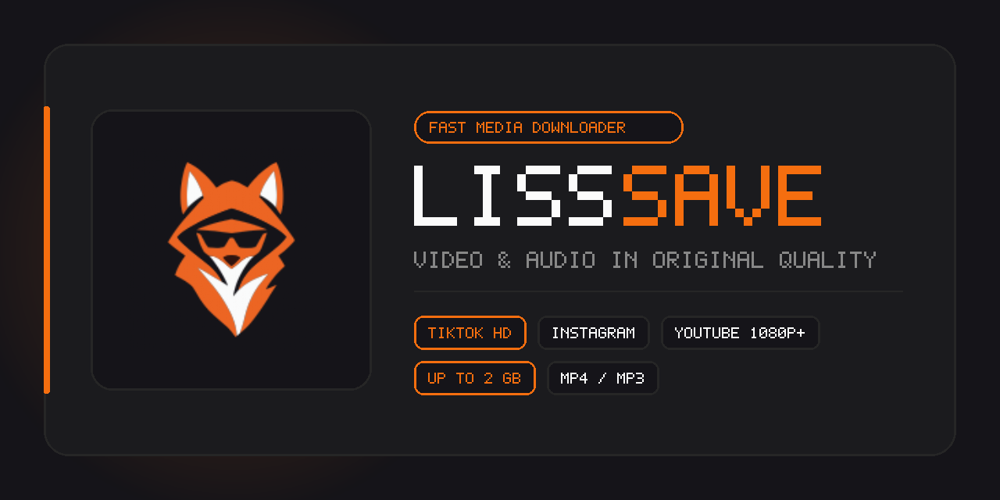

# 🦊 LissSave — Telegram Media Downloader Bot



[](https://www.python.org/)
[](https://docs.aiogram.dev/)
[](https://github.com/yt-dlp/yt-dlp)
[](https://docs.docker.com/compose/)

**LissSave** — высокопроизводительный асинхронный Telegram-бот для скачивания видео и аудио из социальных сетей в оригинальном качестве без водяных знаков. Построен на базе `aiogram 3.x`, `yt-dlp`, `ffmpeg` и локального сервера `telegram-bot-api` с поддержкой отправки файлов объёмом **до 2 ГБ (2000 МБ)**.

---

## ⚡️ Ключевые возможности

- **Мультиплатформенность**:
  - **TikTok** — скачивание видео в HD без водяных знаков и извлечение звука.
  - **Instagram** — Reels и видео-посты.
  - **YouTube & YouTube Shorts** — интерактивный выбор разрешения (`1080p`, `720p`, `480p`, `360p`) с расчётом ориентировочного размера файла.
  - **X (Twitter), VK Видео / Клипы, Reddit, Pinterest, Twitch Clips** и ещё 1000+ площадок, поддерживаемых `yt-dlp`.
- **Лимит файлов до 2 ГБ**: Интегрированный контейнер `aiogram/telegram-bot-api:latest` (`--local`) снимает стандартное ограничение Telegram Bot API в 50 МБ.
- **Идеальная совместимость с iOS и Android**: Склейка потоков в контейнер `.mp4` (`H.264` + `AAC`) с флагом `-movflags +faststart` и передачей точных метаданных (`width`, `height`, `duration`, `supports_streaming=True`).
- **Извлечение аудио**: Конвертация аудиодорожки любого ролика в чистый `.mp3` (`192 kbps`).
- **Защита от перегрузок**: Middleware ограничения параллельных задач (до 2 одновременных загрузок на одного пользователя) и гарантированная очистка временных файлов в блоке `finally`.
- **Админ-панель (`/admin`)**:
  - Подробная статистика пользователей, скачиваний, топ платформ и свободного места на диске.
  - Пошаговая FSM-рассылка (текст, фото, видео, Inline-кнопки) с живым прогресс-баром и автоматической обработкой `TelegramRetryAfter` (`FloodWait`).
  - Горячее обновление `yt-dlp` (`pip install -U yt-dlp`) одной кнопкой прямо из интерфейса бота.

---

## 🚀 Быстрый запуск на Linux-сервере за 3 команды

### Предварительные требования
На сервере должны быть установлены `Docker`, `Docker Compose` и `Git`.
Получите:
1. `BOT_TOKEN` у [@BotFather](https://t.me/BotFather).
2. `TELEGRAM_API_ID` и `TELEGRAM_API_HASH` на сайте [my.telegram.org](https://my.telegram.org) (раздел *API development tools*).

### Развертывание (3 команды)

```bash
# 1. Клонируйте репозиторий и перейдите в директорию проекта
git clone https://github.com/Lissovich-Liss/lisssave-bot.git && cd lisssave-bot

# 2. Создайте файл окружения .env из шаблона и укажите ваши ключи
cp .env.example .env && nano .env

# 3. Соберите и запустите контейнеры в фоновом режиме
docker compose up -d --build
```

Проверка логов в реальном времени:
```bash
docker compose logs -f bot
```

---

## ⚙️ Конфигурация (`.env`)

| Переменная | Обязательно | Описание |
| :--- | :---: | :--- |
| `BOT_TOKEN` | **Да** | Токен бота от `@BotFather` |
| `TELEGRAM_API_ID` | **Да** | App `api_id` с портала [my.telegram.org](https://my.telegram.org) |
| `TELEGRAM_API_HASH` | **Да** | App `api_hash` с портала [my.telegram.org](https://my.telegram.org) |
| `ADMIN_IDS` | **Да** | Telegram ID администраторов через запятую (например, `123456789,987654321`) |
| `LOCAL_API_URL` | Нет | URL локального Bot API (по умолчанию `http://telegram-bot-api:8081`) |
| `AD_CAPTION` | Нет | Нативная HTML-подпись под каждым отправленным медиафайлом |
| `PROXY_URL` | Нет | Прокси для `yt-dlp` (`socks5://user:pass@ip:port` или `http://ip:port`) |
| `MAX_CONCURRENT_DOWNLOADS` | Нет | Максимум одновременных загрузок на 1 пользователя (по умолчанию `2`) |
| `MAX_FILE_SIZE_MB` | Нет | Максимальный размер скачиваемого файла в МБ (по умолчанию `1950`) |

---

## 🍪 Поддержка Cookies (для 18+ контента и Instagram/YouTube Auth)

Если требуется скачивать возрастной контент (`18+`) или обойти лимиты авторизации YouTube / Instagram:
1. Выгрузите cookies из браузера в формате **Netscape HTTP Cookie File** (например, через расширение *Get cookies.txt LOCALLY*).
2. Сохраните файл по пути `data/cookies.txt` на сервере.
3. Бот автоматически обнаружит непустой файл `data/cookies.txt` и будет передавать его в `yt-dlp` без перезапуска контейнера.

---

## 🗂 Архитектура проекта

```text
lisssave-bot/
├── assets/
│   ├── logo.png                 # Фирменный логотип LissSave
│   ├── generate_banner.py       # Генератор приветственного баннера (Pillow)
│   └── welcome_banner.png       # Сгенерированный баннер для команды /start
├── bot/
│   ├── __init__.py
│   ├── main.py                  # Точка входа, инициализация Local Bot API, БД, роутеров
│   ├── config.py                # Валидация конфигурации через Pydantic Settings
│   ├── database/
│   │   ├── __init__.py
│   │   └── db.py                # Асинхронный слой SQLite (aiosqlite, WAL)
│   ├── handlers/
│   │   ├── __init__.py
│   │   ├── user.py              # Команды /start, /help и приём ссылок
│   │   ├── callbacks.py         # Скачивание выбранного качества и отправка в чат
│   │   └── admin.py             # Админ-панель (/admin), статистика, FSM-рассылка, апдейтер yt-dlp
│   ├── services/
│   │   ├── __init__.py
│   │   └── downloader.py        # Обёртка над yt-dlp и ffmpeg/ffprobe
│   ├── keyboards/
│   │   ├── __init__.py
│   │   └── inline.py            # Генераторы Inline-клавиатур
│   └── middlewares/
│       ├── __init__.py
│       └── throttling.py        # Контроль параллельных загрузок и защита от спама
├── data/                        # Примонтированный том (SQLite, cookies.txt, логи, temp)
│   └── .gitkeep
├── .env.example                 # Шаблон переменных окружения
├── .gitignore
├── Dockerfile
├── docker-compose.yml           # Связка bot + aiogram/telegram-bot-api:latest (2 ГБ)
├── requirements.txt
└── README.md
```

---

## 🎨 Палитра бренда

| Название | HEX | Назначение |
| :--- | :--- | :--- |
| **Dark Void** | `#151419` | Основной глубокий тёмный фон |
| **Gluon Grey** | `#1B1B1E` | Поверхности карточек и контейнеров |
| **Slate Grey** | `#262626` | Тонкие обводки и разделители |
| **Liquid Lava** | `#F56E0F` | Основной оранжевый акцент |
| **Snow** | `#FBFBFB` | Основной контрастный текст |
| **Dusty Grey** | `#878787` | Вторичный текст и метаданные |
